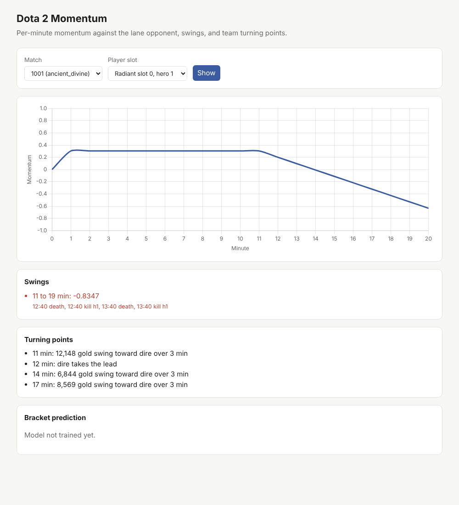

# dota2-ml-inference

Player momentum and skill-bracket analysis for Dota 2 public matches. A small FastAPI app backed by SQLite, with a light dashboard. It runs in one container on a low-RAM laptop and needs no cloud account.



*The screenshot uses the built-in synthetic match, not real data.*

## What it does

- **Momentum curve.** For each minute, a player's gold and XP share against their lane opponent, from -1 to 1. Swings of 0.15 or more within 3 minutes are flagged, with the kills, deaths and purchases inside each swing.
- **Turning points.** Lead changes and the largest 3-minute swings in team gold, with the kills and objectives around them.
- **Bracket fingerprint** (next PR). A scikit-learn classifier that predicts a player's bracket (Herald to Crusader, Archon to Legend, Ancient to Divine, Immortal) from their first 10 minutes, and reports which habits drove the call.

## Data source

[OpenDota API](https://docs.opendota.com/), free tier, no key: about 60 calls a minute and 2,000 a day. Only **parsed** matches carry per-minute series, and replays expire from Valve's servers after roughly two weeks, so ingest samples recent public matches by rank and asks OpenDota to parse the unparsed ones. Raw JSON is never stored; each match becomes compact rows.

## Full replay parsing

OpenDota's summary has values once a minute and positions only for the first 10 minutes. For the full picture, `dota.replays` downloads each match's replay, parses it locally with [gem-dota](https://pypi.org/project/gem-dota/), and stores:

- `hero_ticks`: every hero at every tick (30 a second) with position, health, mana, level, net worth, gold, XP, last hits, denies, hero damage and deaths.
- `combat_log`: every combat log entry that involves a hero (damage, heals, deaths, abilities, items, purchases, gold, XP), with names interned into a `names` table.
- `replay_parses`: replay size, parse time, peak memory and row counts per match, so costs are measured.

It also writes per-minute rows and kill/death events into the main database, so the momentum endpoints work for matches OpenDota never parsed.

Replay data goes to its own file, `data/replays.sqlite`, so the API database stays small. Replays are streamed to disk, parsed one at a time and deleted. Rows are written in batches of 20,000, so memory stays flat however long the game.

| Sampling | Hero rows, 45-min game | Disk per match | 100 matches | 1,000 matches |
| --- | --- | --- | --- | --- |
| Every tick (`--sample-ticks 1`, default) | 810,000 | about 55 MB, plus the combat log | about 6 GB | about 60 GB |
| Once a second (`--sample-ticks 30`) | 27,000 | about 2 MB, plus the combat log | about 0.3 GB | about 3 GB |

Hero-row sizes are measured by writing a synthetic 45-minute game; combat log size is still to be measured on real replays. Replays expire from Valve's servers after roughly two weeks, so parse soon after ingest.

```bash
make ingest BRACKET=ancient_divine LIMIT=20   # finds matches and requests parses, which publishes replay URLs
make pending                                  # picks up the replay URLs
make replays LIMIT=5                          # download, parse, delete; every tick
make replays LIMIT=50 SAMPLE_TICKS=30         # once a second
docker compose run --rm replays file /app/replays/<match_id>.dem   # your own replays, from ./replays
```

## Quick start

```bash
make up        # build the image and start the API + dashboard on http://localhost:8000
make demo      # seed one synthetic match so the dashboard has something to show
make spike     # day-one data check: parsed coverage per bracket, field names, rate-limit headers
make ingest BRACKET=ancient_divine LIMIT=20   # sample real matches and request parses
make pending   # a few minutes later: fetch the matches whose parse finished
make down
```

Without Docker: `pip install -e ".[dev]"`, then `python -m dota.ingest --help`, `uvicorn app.main:app`, and `pytest`.

Set `OPENDOTA_API_KEY` in your shell to use a paid key; the client reads it automatically.

## Endpoints

| Method and path | Returns |
| --- | --- |
| `GET /health` | Status and whether a model is loaded |
| `GET /matches` | Ingested matches, newest first |
| `GET /matches/{match_id}` | Match summary, players, bracket, whether time series is stored |
| `GET /matches/{match_id}/players/{slot}/momentum` | Momentum series against the lane opponent, plus swings with events |
| `GET /matches/{match_id}/turning-points` | Team advantage per minute, lead changes and largest swings |
| `POST /predict/bracket` | Bracket probabilities (returns 503 until the model is trained) |

Interactive docs at `/docs`.

## Layout

```text
app/          FastAPI app and the static dashboard (Chart.js vendored, MIT)
dota/         OpenDota client, ingest CLI, replay pipeline, SQLite schema, momentum, synthetic demo
scripts/      spike.py, the day-one data check
tests/        pytest suite, no network needed
docker/       Dockerfile (python:3.12-slim; about 490 MB with the replay parser, 205 MB API-only)
compose.yaml  api service plus on-demand ingest and spike tools
```

## Resource use

The API container idles at about 35 MB of RAM and is capped at 384 MB in `compose.yaml`. Ingest streams one match at a time and is capped at 256 MB.

## Roadmap

1. Run the spike and confirm parsed coverage per bracket.
2. Feature builder and bracket model, wired into `/predict/bracket` and the dashboard.
3. Optional `infra/aws/` Terraform module: the same image on AWS Lambda behind a function URL, with `make deploy` / `make destroy` and a cost breakdown. Nothing else in the repo depends on AWS.
